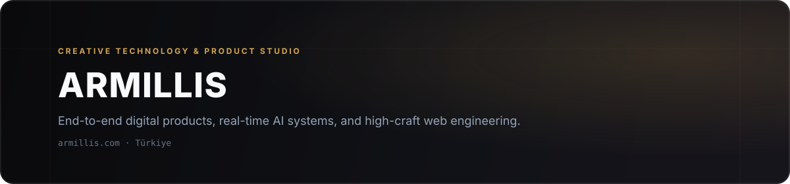

  

**Armillis** is a creative technology and product engineering studio founded by [**Mert Akdağ**](https://github.com/MertAkdag). We design, engineer, and ship end-to-end software systems—from real-time AI models and SaaS products to interactive 3D web experiences and brand identities.

---

### What We Build

- **AI & Voice Infrastructure** — Ultra-low-latency speech synthesis, local/edge inference, and AI-native consumer tools.
- **Vertical SaaS & Platforms** — Point-of-sale, operational workflow software, QR ordering, and multi-tenant web/mobile systems.
- **Web & Brand Engineering** — High-craft interactive web platforms (React, TypeScript, Three.js / WebGL, custom Node backends) and cohesive visual identities.

---

### Open Source & Public Research

| Project | Focus | Highlights |
| --- | --- | --- |
| [**armillis-tts**](https://github.com/MertAkdag/armillis-tts) | Turkish Text-to-Speech | `8.6M` params · `0.92%` WER on Freya-TR-Eval · `~4 ms` first-audio latency · `1,300×` real-time batched GPU throughput |
| [**@mertakdag/react-native-story-viewer**](https://github.com/MertAkdag/react-native-story-viewer) | React Native / Expo UI | 60fps story ring tray & full-screen image/video story viewer with Reanimated gestures and headless hook API |

---

### Connect

- **Website:** [armillis.com](https://armillis.com)
- **Founder:** [Mert Akdağ](https://mertakdag.com) ([@MertAkdag](https://github.com/MertAkdag))
- **Inquiries:** [info@armillis.com](mailto:info@armillis.com)
